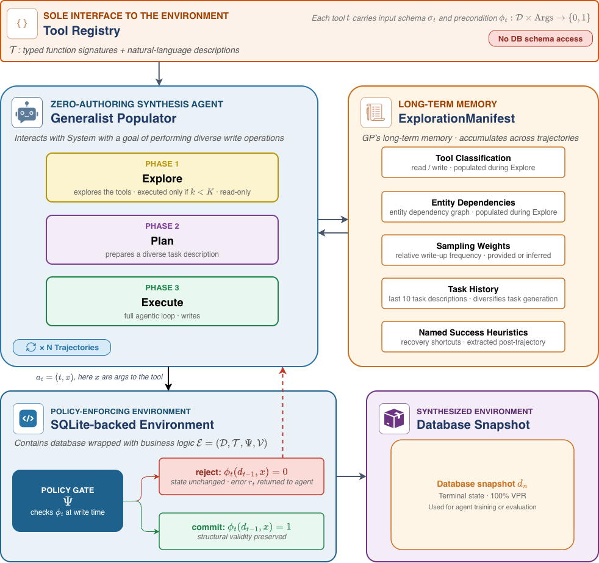

<div align="center">

# Synthesis Through Simulation

**Generating coherent enterprise data by letting an LLM agent *act* inside policy-enforcing simulated systems — no schemas, no templates, no per-domain authoring.**

[](https://arxiv.org/abs/2610.10549)
[](LICENSE)
[](https://www.python.org/)
[](https://api.reuse.software/info/github.com/SAP/synthesis-through-simulation)



</div>

---

## About this project

Most synthetic-data generators learn to *imitate* a table. **Synthesis Through
Simulation (STS)** takes a different route: it generates data as the **by-product
of an agent doing realistic work**. A domain-agnostic LLM agent — the
**Generalist Populator (GP)** — is dropped into a simulated enterprise system
whose only interface is a set of typed tools (the *Tool Registry*). The GP has
**no access to the database schema**. It explores the tools, infers the entity
graph, and then performs thousands of write operations through the system's own
APIs. Every write passes through a **policy gate** that enforces the
environment's business rules at commit time, so the resulting database snapshot
is **structurally valid by construction**.

The same run yields two artifacts at once:

- a **database snapshot** — coherent, constraint-valid synthetic records, and
- a **labelled trajectory** — the full sequence of tool calls, usable for agent
  training and evaluation.

> **Headline result (from the paper):** the Generalist Populator reaches
> **0.88 average marginal distribution fidelity** and **100 % constraint
> satisfaction** across **all ten environments** — with **zero per-domain
> authoring**.

## Why it's different

| | Tabular generators (CTGAN/TVAE) | Blind task agents | **STS — Generalist Populator** |
|---|:---:|:---:|:---:|
| Needs a seed table to copy | ✅ required | ❌ | ❌ |
| Needs the DB schema | ✅ | ✅ | ❌ **schema-free** |
| Per-domain authoring | — | ✅ intents/tasks | ❌ **zero authoring** |
| Guaranteed constraint validity | ❌ | partial | ✅ **by construction** |
| Produces evaluation trajectories | ❌ | ✅ | ✅ |
| Works on empty / cold-start tables | ❌ | ✅ | ✅ |

## How it works

The agent interacts with the environment through **one interface only** — a
registry of typed tools, each carrying an input schema and a precondition.
Nothing in the loop sees SQL.

1. **Explore** *(Phase 1, runs only while `k < K`)* — call read tools, classify
   every tool as read/write, infer entity dependencies, estimate how often each
   write should fire. Write tools are *blocked* here; the agent still sees their
   schemas.
2. **Plan** *(Phase 2)* — a single structured LLM call turns the learned graph
   into a diverse next task ("create a round-trip reservation with insurance for
   an existing user…").
3. **Execute** *(Phase 3)* — a full agentic loop that performs the writes. Each
   write hits the **policy gate** `Ψ`, which checks the tool precondition
   `φ_t(d, x)` against current state: **commit** if valid, **reject** (state
   unchanged, error returned to the agent) otherwise.

Everything the GP learns is persisted in the **ExplorationManifest** — its
long-term memory of tool classifications, entity dependencies, sampling weights,
recent task history, and named success heuristics — and reused across
trajectories. After *N* trajectories you get a terminal **database snapshot**
with 100 % validation pass rate.

This whole loop is the figure above.

## Environments

Eleven policy-enforcing mock enterprises ship in the box — **172 business-rule
checks** in total. The GP runs on every one with the same code and no
environment-specific knowledge.

| Environment | Domain | Tables | Rule checks |
|---|---|:---:|:---:|
| `airline` | Flight reservations, payments, baggage | 9 | 13 |
| `banking` | Accounts & customers | 3 | 10 |
| `cloud` | Cloud infrastructure management | programmatic | 6 |
| `ecommerce` | Orders & products | 4 | 9 |
| `forum` | Discussion threads & posts | 6 | 10 |
| `hr` | Employees, time-off, recruiting, comp | 71 | 61 |
| `it_management` | Helpdesk tickets | 2 | 10 |
| `obfuscated_airline` | Airline with scrambled API names (transfer test) | 9 | 13 |
| `pharmacy` | Prescription management | 4 | 9 |
| `retail` | Retail orders & payments | 8 | 19 |
| `university` | Student enrollments | 4 | 12 |

## Installation

Requires **Python 3.13** and [`uv`](https://docs.astral.sh/uv/).

```bash
git clone https://github.com/SAP/synthesis-through-simulation.git
cd synthesis-through-simulation

# Install everything, including the Generalist Populator (deepagents / LangChain)
uv sync --all-extras
source .venv/bin/activate

synthesize --help
```

The `generalist` extra pulls in `deepagents`, `langchain-anthropic`,
`langchain-openai`, and `sqlite-vec`, which the GP needs.

## Configure the LLM

The GP drives all three phases with an LLM, reached through an
OpenAI/Anthropic-compatible proxy (we use a
[LiteLLM proxy](https://docs.litellm.ai/docs/simple_proxy)). Copy the template
and fill it in:

```bash
cp .env.example .env
```

| Variable | Description | Example |
|---|---|---|
| `SYNTHESIZE_MODEL` | Chat model served by the proxy | `claude-4.5-opus`, `gpt-4.1`, `gemini-2.5-pro` |
| `SYNTHESIZE_PROXY_BASE_URL` | Base URL of the proxy | `http://localhost:4000` |
| `SYNTHESIZE_EMBEDDING_MODEL` | Embedding model (used to embed tool descriptions) | `text-embedding-3-large` |
| `SYNTHESIZE_LLM_API` | *(optional)* force `anthropic` or `openai` client surface | `openai` |

> **Proxy tip.** `deepagents` tags Anthropic requests with `cache_control`
> prompt-cache markers. Some gateways reject that extra field
> (`cache_control: Extra inputs are not permitted`). Set
> **`SYNTHESIZE_LLM_API=openai`** to route `claude-*` models through the
> OpenAI-compatible `/v1` endpoint, which skips the caching middleware while
> hitting the same model.

## Quickstart

```bash
# 1. Build a clean environment database from schema + reference data
synthesize --env airline setup
synthesize --env airline snapshot      # save the clean baseline

# 2. Run the Generalist Populator (10 trajectories, K=3 exploration cycles)
synthesize --env airline batch \
    --synthesizer generalist_populator \
    --n 10 \
    --explore-runs 3

# 3. Confirm every business rule still holds
synthesize --env airline validate

# 4. Score the run's fidelity
python scripts/compute_fidelity.py --env airline --all-runs
```

Each batch streams to `.runs/<env>_batch_informed_<timestamp>/` containing the
final `snapshot.db`, the `baseline.db`, `trajectories.jsonl`, and a validation
`report.json`.

### Useful flags

| Flag | Effect |
|---|---|
| `--explore-runs K` | Number of read-only exploration cycles before writing |
| `--explore-mode interleaved` | Explore on every trajectory (K = ∞) |
| `--no-heuristics` | Disable the learned recovery heuristics |
| `--no-plan` | Skip the structured Plan phase |

## Benchmarking

The `benchmarking/` package implements the paper's fidelity suite:

- **MDF** — Marginal Distribution Fidelity (per-column JSD similarity)
- **PDF** — Pairwise Distribution Fidelity (column-pair joints)
- **CDF** — Cross-table Distribution Fidelity (relational fidelity)
- **WO** — mean successful write operations per trajectory
- **VPR** — Validation Pass Rate (business-rule satisfaction)

```bash
# Full metric suite over a finished run directory
synthesize --env airline benchmark \
    --run-dir .runs/airline_batch_informed_<timestamp> \
    --metrics all

# Or just fidelity, straight from the CLI helper
python scripts/compute_fidelity.py --run-dir .runs/airline_batch_informed_<timestamp>
```

## Onboarding a new environment

The GP is fully domain-agnostic: expose read/write tools and it plugs in. Create
`src/synthesize/environments/<your_env>/` mirroring an existing one (e.g.
`banking/`):

```
your_env/
├── apis/            # tool functions (plain Python callables)
├── db/              # schema.sql, db.py (DB_PATH), reference_data.py (seed)
├── quality_priors.py  # distribution priors for MDF/PDF (optional)
├── setup.py         # DB initialization entry point
└── validate.py      # @check business-rule functions
```

Then declare a `TOOL_REGISTRY` in
`src/synthesize/synthesizer/<your_env>_synthesizer.py` (tool name → `fn`,
`description`, `input_schema`), register the env in `synthesis_runner.py`, and
run:

```bash
synthesize --env your_env setup
synthesize --env your_env batch --synthesizer generalist_populator --n 50 --explore-runs 3
synthesize --env your_env explore show     # inspect what the GP learned
```

## Reproducing the paper

```bash
# All GP experiments (sections selectable via SECTION=...)
bash scripts/run_gp_all_experiments.sh

# Tabular baselines (CTGAN / TVAE) — needs: uv pip install sdv scipy
python scripts/tabular_baseline_eval.py

# EnvScaler blind-agent baseline
python scripts/run_envscaler_comparison.py --tasks scripts/envscaler_airline_tasks.json --n 100
```

See `scripts/run_gp_all_experiments.sh` for the available `SECTION` values
(`gp_infinite`, `gp_k0`, `gp_k3`, `gp_k_ablation`, `gp_ablation_noheuristics`,
`gp_ablation_noplan`).

## Repository structure

```
src/synthesize/
├── cli.py                     # `synthesize` entry point
├── synthesis_runner.py        # orchestrator: setup / batch / benchmark / validate
├── synthesizer/
│   ├── generalist_populator.py            # the GP agent (core contribution)
│   ├── generalist_populator_synthesizer.py# CLI adapter for the GP
│   ├── _llm.py                            # proxy-aware chat-model builder
│   └── <env>_synthesizer.py               # per-env TOOL_REGISTRY
├── exploration/
│   ├── manifest.py            # ExplorationManifest (tool graph, priors, heuristics)
│   ├── planning.py            # Plan phase (PlanRecipe)
│   └── prompts.py             # Explore / Execute system prompts
├── environments/<env>/        # 11 policy-enforcing mock enterprises
└── benchmarking/              # MDF / PDF / CDF / WO / VPR metrics
scripts/                       # paper reproduction & baselines
```

## Citation

If you use this work, please cite:

```bibtex
@misc{li2026synthesissimulationgeneratingcoherent,
      title={Synthesis Through Simulation: Generating Coherent Enterprise Data via Scalable Agent-System Interaction},
      author={Yipeng Li and Ashutosh Hathidara and Jane Lo and Harshavardhan Abichandani and Gunraj Singh and Atin Ghosh},
      year={2026},
      eprint={2610.10549},
      archivePrefix={arXiv},
      primaryClass={cs.AI},
      url={https://arxiv.org/abs/2610.10549},
}
```

## Authors

[Yipeng Li](https://www.linkedin.com/in/yipengli/)\* ·
[Ashutosh Hathidara](https://www.linkedin.com/in/ashutosh1919/)\* ·
[Jane Lo](https://www.linkedin.com/in/janeel/) ·
[Harshavardhan Abichandani](https://www.linkedin.com/in/harsh-abhi/) ·
[Gunraj Singh](https://www.linkedin.com/in/gunraj-singh-85b70023b/) ·
[Atin Ghosh](https://www.linkedin.com/in/atin-ghosh-3a8b5831/)

<sub>\* Equal contribution.</sub>

## Support, Feedback, Contributing

This project is open to feature requests/suggestions, bug reports etc. via
[GitHub issues](https://github.com/SAP/synthesis-through-simulation/issues).
Contribution and feedback are encouraged and always welcome. For more
information about how to contribute, the project structure, as well as
additional contribution information, see our
[Contribution Guidelines](CONTRIBUTING.md).

## Security / Disclosure

If you find any bug that may be a security problem, please follow our
instructions [in our security policy](https://github.com/SAP/synthesis-through-simulation/security/policy)
on how to report it. Please do not create GitHub issues for security-related
doubts or problems.

## Code of Conduct

We as members, contributors, and leaders pledge to make participation in our
community a harassment-free experience for everyone. By participating in this
project, you agree to abide by its
[Code of Conduct](https://github.com/SAP/.github/blob/main/CODE_OF_CONDUCT.md)
at all times.

## Licensing

Copyright 2026 SAP SE or an SAP affiliate company and synthesis-through-simulation
contributors. Please see our [LICENSE](LICENSE) for copyright and license
information. Detailed information including third-party components and their
licensing/copyright information is available
[via the REUSE tool](https://api.reuse.software/info/github.com/SAP/synthesis-through-simulation).
